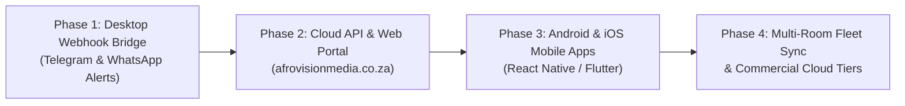

# Sound Sentinel Pro — Cloud, Mobile & Online Architecture Blueprint
> **Enterprise Vision & Roadmap**: Sound Sentinel Ecosystem v2.0  
> **Brand & Organization**: **Afro Vision Media PTY (Ltd)**  
> **System Architect**: **Tanyaradzwa Bvute**  
> **Target Platforms**: Windows Desktop • Android • iOS • Cloud Web Portal

---

## 🧭 1. Executive Summary & Core Philosophy

The primary competitive advantage of Sound Sentinel Pro is **100% Edge AI Privacy**:
- **Zero Raw Audio Streams to the Cloud**: Microphone recordings NEVER leave the local device (phone or desktop).
- **Lightweight Telemetry Payload**: Only lightweight **JSON alert packets** (~1 KB) containing event name, confidence rating, timestamp, and device identifier are transmitted over the cloud.
- **POPIA & GDPR Compliant by Design**: Because private voices and domestic sounds are not transmitted or stored on remote servers, the platform guarantees zero eavesdropping liability.

```
       [ LOCAL PHYSICAL ENVIRONMENT ]                         [ AFRO VISION CLOUD & MOBILE ]
+------------------------------------------+
|  Local Acoustic Sensor (Desktop / Phone) |
|  - Real-time Mic Capture                 |
|  - On-Device YAMNet Neural DSP (RAM)     |
|  - Noise Gate & Resampling               |
+--------------------+---------------------+
                     |
        [Only when anomaly is detected]
       (Encrypted 1 KB JSON Alert Packet)
                     |
                     v
+------------------------------------------+           +-----------------------------------------+
|     Afro Vision Cloud Gateway (API)      | --------> | Mobile Companion App & Notifications    |
| - Device Fleet Registry                  |           | - WhatsApp Instant Alert Bot            |
| - Multi-Room Node Routing                |           | - Telegram Emergency Channel            |
| - Incident Audit Storage                 |           | - iOS / Android Native Push (FCM/APNs)  |
+------------------------------------------+           | - Live Web Portal (afrovisionmedia)     |
                                                       +-----------------------------------------+
```

---

## 📱 2. Mobile Strategy (Android & iOS)

The mobile ecosystem serves two distinct operating modes:

### Mode A: Mobile Sensor Node (Turn Any Old Smartphone into a Wireless Ear)
- **Use Case**: Users keep a secondary or spare phone plugged in near a front door, nursery, kitchen, or office.
- **On-Device Machine Learning**: Uses **TensorFlow Lite (TFLite) YAMNet** running natively on the device's NPU/CPU.
- **Battery & Efficiency**: Employs an aggressive RMS noise gate — neural inference only executes when sound levels exceed ambient background noise.
- **Connectivity**: Sends alerts to the Afro Vision Cloud over local Wi-Fi or cellular data.

### Mode B: Mobile Companion Monitor (Primary Personal Phone)
- **Use Case**: Carried in the user's pocket wherever they go.
- **Features**:
  1. **Instant Push Alerts**: Receives critical notifications when glass breaks, smoke alarms sound, or babies cry at home.
  2. **Remote Arm / Disarm**: Toggle surveillance status across all home nodes remotely.
  3. **Live Fleet Telemetry**: Displays the status of each sensor node (e.g. *Living Room Laptop: Armed*, *Baby Room Phone: Active*).
  4. **Emergency Quick-Actions**: One-tap panic siren, notify family members, or contact emergency services.

---

## ☁️ 3. Cloud & Online Portal Architecture

### 1. Online Dashboard (`portal.afrovisionmedia.co.za` or `afrovisionmedia.co.za/sentinel-hub`)
A clean, responsive web application for managing devices and viewing telemetry:
- **User Authentication**: Secure multi-tenant login (JWT / Supabase Auth / Firebase).
- **Live Fleet View**: Real-time WebSocket connection displaying active listening nodes and live decibel status.
- **Searchable Event Logs**: Chronological incident timeline with audio category tags, confidence bars, and CSV/PDF export for insurance or police reports.
- **Rule Engine**: Custom alert rules (e.g., *"Only alert me for glass break or screams after 10:00 PM"*).

### 2. Multi-Channel Alert Gateway
In South Africa and worldwide, WhatsApp is the dominant messaging channel. Sound Sentinel v2.0 connects to multiple dispatch channels:

| Notification Channel | Latency | Setup Cost | Ideal For |
| :--- | :--- | :--- | :--- |
| **WhatsApp Business API** | < 2 seconds | Low (Twilio / Meta API) | Direct push to homeowners and family groups |
| **Telegram Bot** | < 1 second | 100% Free | Instant real-time alerts with zero setup cost |
| **Native Mobile Push (FCM / APNs)** | < 1 second | Free (Firebase) | In-app mobile notifications |
| **Web Push (PWA)** | < 2 seconds | Free (VAPID Keys) | Browser desktop/mobile popups |
| **SMS / Voice Fallback** | < 5 seconds | Per SMS | Critical smoke/fire alerts when internet is weak |

---

## 🛠️ 4. Immediate Step: Cloud Webhook Dispatcher for Desktop v1.0

Before full mobile apps are released, we can equip the current Desktop app with a **Cloud Webhook Dispatcher**.

### How it works:
Users can paste their webhook URL (such as a Telegram Bot token, Discord Webhook, Zapier, Make, or custom API endpoint) in the Desktop Settings:

```json
// Sample JSON payload sent by Sound Sentinel Desktop:
{
  "system": "Sound Sentinel Pro",
  "version": "1.0.0",
  "organization": "Afro Vision Media PTY (Ltd)",
  "developer": "Tanyaradzwa Bvute",
  "nodeId": "DESKTOP-LIVING-ROOM",
  "event": "Smoke detector, smoke alarm",
  "category": "Emergency & Safety",
  "confidence": 0.985,
  "alertLevel": "critical",
  "timestamp": "2026-10-16T15:58:00.000Z",
  "timeFormatted": "03:58:00 PM"
}
```

This immediately bridges the desktop app to mobile phones today!

---

## 🚀 5. Phased Implementation Roadmap



1. **Phase 1 (Immediate)**: Cloud Webhook integration inside Sound Sentinel Pro Desktop to send instant Telegram/WhatsApp alerts to phones.
2. **Phase 2 (Quarter 1)**: Online Cloud Portal on `afrovisionmedia.co.za` for device registration, cloud event logging, and rule configuration.
3. **Phase 3 (Quarter 2)**: Cross-platform mobile application (Android / iOS) with dual sensor/companion mode.
4. **Phase 4 (Quarter 3)**: Enterprise multi-site acoustic telemetry for commercial buildings, schools, and industrial facilities.
